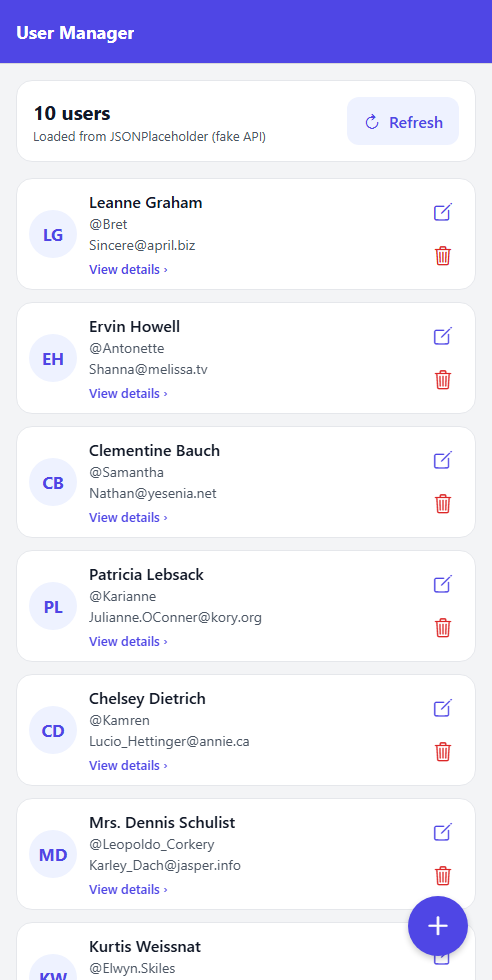
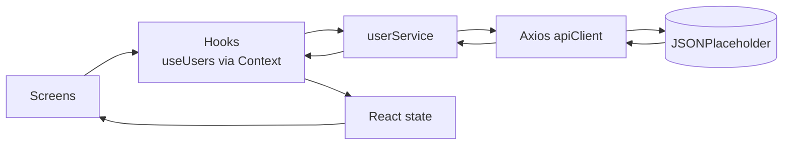

# User Manager: a beginner-friendly React Native CRUD app

A small but complete **React Native + Expo + TypeScript** app that manages a list of users through
the fake REST API [JSONPlaceholder](https://jsonplaceholder.typicode.com). It is built for **learning**:
the code is commented, and the [`docs/`](docs) folder explains how every part works internally,
with workflow and sequence diagrams.

<p align="center">
  
  <br />
  <sub>Home screen with live data. This capture is a browser render made during verification; on a phone the native header and status bar look slightly different.</sub>
</p>

## Features

- **Create** a user (form with field-level validation, disabled button while saving)
- **Read** the user list (`FlatList`, pull-to-refresh, Refresh button, total count) and one user's full details
- **Update** a user (form pre-filled with the current values)
- **Delete** a user (confirmation dialog, kept in the list if the API fails)
- Loading indicators, empty state, error messages with **Try again**, success / failure dialogs
- An honest strategy for the **fake API**: changes are kept in app memory for the session, with
  "New" / "Edited" badges and a warning before reloading the original data

## Tech stack

| Technology | Version | Purpose |
|---|---|---|
| Expo SDK | 58 | Development tooling, Expo Go |
| React Native | 0.88 | Mobile UI |
| React | 19.3 | Components and hooks |
| TypeScript | 6.0 (strict) | Type safety |
| React Navigation | 7 (native stack) | Screen navigation |
| Axios | 1.21 | HTTP client |
| Jest + jest-expo + Testing Library | 30 / 58 / 14 | Tests |

No Redux and no other state library: shared state uses React Context.

## Quick start

**Requirements:** Node.js `^22.13.0`, `^24.3.0` or `>=26`, and the **Expo Go** app (latest version)
on an Android or iOS phone, or an Android emulator.

```bash
# 1. Install dependencies
npm install

# 2. Start the development server
npx expo start
#    If port 8081 is busy (on this PC Docker Desktop uses it), answer "Y" or run:
npx expo start --port 8082

# 3. Open the app
#    Phone:    scan the QR code with Expo Go (Android) or the Camera app (iOS), same Wi-Fi
#    Emulator: start an Android emulator, then press  a  in the terminal
#    Network blocked?  npx expo start --tunnel

# 4. Stop: press Ctrl+C in the terminal
```

Full step-by-step instructions (emulator setup, physical devices, iOS, debugging):
[docs/07-project-setup-and-execution.md](docs/07-project-setup-and-execution.md).

## Scripts

| Command | What it does |
|---|---|
| `npm start` / `npx expo start` | Start Metro + QR code |
| `npm run android` | Start and open on a running Android emulator/device |
| `npm run ios` | Start and open on the iOS Simulator (macOS only) |
| `npm test` | Unit + integration tests (offline) |
| `npm run test:live` | Tests against the real JSONPlaceholder API (needs internet) |
| `npm run typecheck` | TypeScript check (`tsc --noEmit`) |
| `npx expo-doctor` | Check dependency versions and config |

## How it works (in one picture)



Screens never call the API directly. They call **hooks**, hooks call the **service**, and the
service uses the configured **Axios** client. After a successful response, the hook updates **React
state** and React re-renders the screens. Details: [docs/02-application-architecture.md](docs/02-application-architecture.md).

### About the fake API

JSONPlaceholder **simulates** create, update and delete (it answers `201`/`200`), but it **never
stores anything**. The app therefore keeps the results in local React state for the current session.
After **restarting the app** or pressing **Refresh**, the original 10 users come back, because they
are fetched from the server again and the server never changed. The app warns you before a refresh
discards session changes.

## Project structure

```text
App.tsx                  Root: SafeAreaProvider → UsersProvider → AppNavigator
src/
  navigation/            AppNavigator.tsx (stack), types.ts (screen params)
  screens/               HomeScreen, UserDetailsScreen, AddUserScreen, EditUserScreen
  components/            UserCard, UserForm, CustomButton, CustomInput, IconButton,
                         LoadingIndicator, EmptyState, MessageBanner, InfoRow
  context/               UsersContext.tsx (shares one useUsers instance)
  hooks/                 useUsers.ts (list + CRUD), useUserDetails.ts (one user)
  services/              apiClient.ts (Axios), userService.ts (CRUD calls)
  types/                 User.ts, icon.ts
  utils/                 validation.ts, errorHandling.ts, formatters.ts
  constants/             apiConstants.ts, theme.ts
__tests__/App.test.tsx   Whole-app integration tests
docs/                    Technical documentation (below)
```

## Documentation

| # | Document | What you learn |
|---|---|---|
| 01 | [React Native Beginner Guide](docs/01-react-native-beginner-guide.md) | React Native, Expo, TypeScript, components, props, state, hooks, navigation, rendering |
| 02 | [Application Architecture](docs/02-application-architecture.md) | Layers, folders, component communication, data flow, the fake-API strategy, design decisions |
| 03 | [Application Workflows](docs/03-application-workflows.md) | All workflow, sequence, lifecycle and error-handling diagrams |
| 04 | [API Communication](docs/04-api-communication.md) | REST, HTTP methods, Axios, headers, bodies, status codes, real request/response examples, debugging |
| 05 | [CRUD Internal Implementation](docs/05-crud-internal-implementation.md) | Each operation traced from button click to re-render |
| 06 | [Components and Hooks](docs/06-react-native-components-and-hooks.md) | `useState`, `useEffect`, `useCallback`, `FlatList`, `TextInput`, `Pressable`, `Alert`... |
| 07 | [Setup and Execution](docs/07-project-setup-and-execution.md) | Install, run on emulator / device / iOS, test, debug, stop |
| 08 | [Troubleshooting](docs/08-troubleshooting.md) | Metro, dependencies, network, navigation, TypeScript, crashes, Expo config |

## Verification status

What was run and passed on the development machine (Windows 11, Node 24.21):

| Check | Result |
|---|---|
| `npm run typecheck` | ✅ no errors (strict mode, app + tests) |
| `npm test` | ✅ 7 suites, 62 tests passed |
| `npm run test:live` (real JSONPlaceholder) | ✅ 6 tests passed |
| `npx expo-doctor` | ✅ 20/20 checks passed |
| `npx expo export --platform android` | ✅ Hermes bundle built |
| `npx expo start` + bundle download | ✅ Dev server served the Android bundle (HTTP 200) |
| Rendered UI with live data | ✅ Home screen (browser render, screenshot above) |
| Running on an Android emulator / physical phone | ⚠️ **Not verified here**: no Android SDK/emulator or phone was available on the build machine. Follow [docs/07](docs/07-project-setup-and-execution.md) to run it. |
