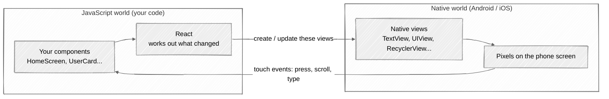
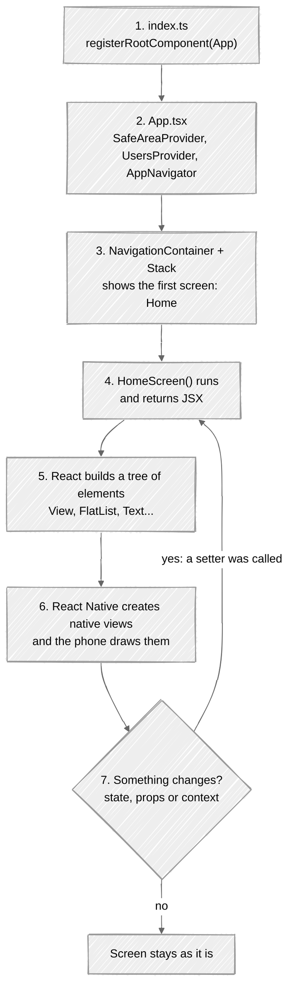

# 01 · React Native Beginner Guide

This guide explains the basic ideas you need before reading the code of this app.
Every example is taken from this project, so you can open the file and see it in context.

> **Reading order:** 01 (this file) → [02 Architecture](02-application-architecture.md) →
> [03 Workflows](03-application-workflows.md) → [04 API](04-api-communication.md) →
> [05 CRUD internals](05-crud-internal-implementation.md) → [06 Components & Hooks](06-react-native-components-and-hooks.md).
> Use [07 Setup](07-project-setup-and-execution.md) to run the app and [08 Troubleshooting](08-troubleshooting.md) when something breaks.

---

## 1. What is React Native?

**React Native** is a framework for building **real mobile apps** (Android and iOS) using
**JavaScript/TypeScript** and **React**.

- You write your app **once**, in TypeScript.
- React Native turns your components into **real native UI elements**: a `<Text>` becomes an
  Android `TextView` or an iOS `UILabel`. It is *not* a website inside a phone.
- The same code runs on Android and iOS. Only a few things differ per platform (for example, how
  dialogs look).

## 2. How does React Native work?

Think of a React Native app as **two worlds that talk to each other**:



**What the diagram shows:**

1. Your TypeScript code runs inside a JavaScript engine called **Hermes**, which ships with the app.
2. React compares the old and new versions of your UI and works out the **smallest set of changes**.
3. React Native's renderer (called *Fabric* in the "New Architecture") creates or updates the
   matching **native views**.
4. When the user touches the screen, the native side sends an **event** (like `onPress`) back to your
   JavaScript code, which updates state, and the cycle starts again.

You rarely need to think about the native side. You write components, and React Native handles the rest.

## 3. React JS (web) vs React Native

If you know React for the web, most ideas carry over. The main difference is that **there is no HTML
and no CSS file**.

| Web (React JS) | React Native | Used in this app |
|---|---|---|
| `<div>` | `<View>` | Every layout box |
| `<p>`, `<span>`, `<h1>` | `<Text>` (**all** text must be inside `<Text>`) | Names, labels, messages |
| `<input>` | `<TextInput>` | Form fields in `CustomInput.tsx` |
| `<button>` + `onClick` | `<Pressable>` + `onPress` | `CustomButton.tsx`, `IconButton.tsx` |
| `<ul>` + `.map()` | `<FlatList>` | The user list in `HomeScreen.tsx` |
| CSS files / classes | `StyleSheet.create({...})` objects | At the bottom of every component |
| `px`, `rem` | Unitless numbers (density-independent pixels) | `padding: 16` |
| Flexbox is optional; default row | Flexbox **always on**, default `flexDirection: 'column'` | All layouts |
| `window.alert()` | `Alert.alert()` (a native dialog) | Delete confirmation |
| React Router / URLs | React Navigation / screen stack | `AppNavigator.tsx` |
| Browser DevTools | React Native DevTools (press `j` in the terminal) | See [07](07-project-setup-and-execution.md) |

## 4. What is Expo?

**Expo** is a set of tools and libraries that makes React Native much easier:

| Part of Expo | What it does for you |
|---|---|
| **Expo CLI** (`npx expo start`) | Starts the development server (**Metro**), shows a QR code, reloads the app when you save a file. |
| **Expo Go** (phone app) | A ready-made app from the Play Store / App Store that can run your project. **No Android Studio or Xcode needed** to start learning. |
| **Expo SDK** (`expo-status-bar`, `expo-font`...) | Ready-made native features with a JavaScript API. |
| `npx expo install <package>` | Installs the library version that is **compatible with your Expo SDK** (here SDK 58). Always prefer it over `npm install` for React Native libraries. |

This project was created with `npx create-expo-app@latest --template blank-typescript`.

## 5. What does TypeScript do?

**TypeScript** is JavaScript plus **types**. Types describe the *shape* of your data, so mistakes are
found **while you write code**, not when the app crashes on a phone.

From [`src/types/User.ts`](../src/types/User.ts):

```ts
export interface UserRequest {
  name: string;
  username: string;
  email: string;
  phone: string;
  website: string;
}
```

Now TypeScript protects us:

```ts
const request: UserRequest = { name: 'John', email: 'john@example.com' };
//    ^ Error: Property 'username' is missing ...

user.fullName;
//   ^ Error: Property 'fullName' does not exist on type 'User'.
```

Run the TypeScript checker any time with:

```bash
npm run typecheck
```

> Types disappear when the app runs. That is why the user service *also* checks the shape of API
> responses at runtime (see `isUserLike` in [`userService.ts`](../src/services/userService.ts)).

## 6. What is a component?

A **component** is a function that returns UI (JSX). Components are the building blocks of every
screen. A tiny real example, [`LoadingIndicator.tsx`](../src/components/LoadingIndicator.tsx):

```tsx
export default function LoadingIndicator({ message = 'Loading...' }: LoadingIndicatorProps) {
  return (
    <View style={styles.container}>
      <ActivityIndicator size="large" color={colors.primary} />
      <Text style={styles.message}>{message}</Text>
    </View>
  );
}
```

- It is a normal TypeScript **function**.
- It returns **JSX**, the HTML-like syntax that describes what to show.
- Its name starts with a **capital letter**, so you can use it like a tag: `<LoadingIndicator />`.

This app has two kinds of components:

- **Screens** (`src/screens/`) are whole pages: Home, Details, Add, Edit.
- **Reusable components** (`src/components/`) are building blocks: button, input, card...

## 7. What are props?

**Props** (properties) are the **inputs** of a component, passed from the parent like HTML attributes.
A component **cannot change its own props**; it only reads them.

[`UserCard.tsx`](../src/components/UserCard.tsx) receives a user and three functions:

```tsx
interface UserCardProps {
  user: User;
  sessionChange?: SessionChange;
  isDeleting?: boolean;
  onView: (user: User) => void;
  onEdit: (user: User) => void;
  onDelete: (user: User) => void;
}
```

[`HomeScreen.tsx`](../src/screens/HomeScreen.tsx) gives it those props:

```tsx
<UserCard
  user={item}
  sessionChange={sessionChanges[item.id]}
  isDeleting={deletingId === item.id}
  onView={openDetails}
  onEdit={openEdit}
  onDelete={confirmDelete}
/>
```

**Data goes down** through props (`user`). **Events go up** through function props (`onDelete`):
the card does not know *how* to delete. It just calls `onDelete(user)`, and the Home screen decides.

## 8. What is state?

**State** is data that **belongs to a component and can change over time**. When state changes,
React **re-renders** the component, which means it calls the function again and updates the screen.

From [`CustomInput.tsx`](../src/components/CustomInput.tsx):

```tsx
const [isFocused, setIsFocused] = useState(false);
// ...
<TextInput
  onFocus={() => setIsFocused(true)}   // border turns blue
  onBlur={() => setIsFocused(false)}   // border turns grey again
  style={[styles.input, isFocused ? styles.inputFocused : null]}
/>
```

| Props | State |
|---|---|
| Given by the parent | Owned by the component itself |
| Read-only | Changed with its setter (`setIsFocused`) |
| Example: `user` in `UserCard` | Example: `isFocused` in `CustomInput` |

> **Golden rule:** never change state directly (`isFocused = true` does nothing). Always call the
> setter (`setIsFocused(true)`), because that is how React knows it must re-render.

## 9. What are React Hooks?

**Hooks** are special functions whose names start with `use`. They give function components
"powers" like state and side effects.

| Hook | What it gives you | Where it is used here |
|---|---|---|
| `useState` | A value that survives re-renders + a setter | Every form field, `deletingId`, `users` |
| `useEffect` | Run code **after** rendering (for example, fetch data) | Load users when Home opens |
| `useCallback` | Keep the **same function** between renders | `loadUsers`, `confirmDelete` |
| `useContext` | Read shared data without passing props through every level | `useUsersContext()` |
| Custom hooks | Your own reusable logic built from other hooks | `useUsers`, `useUserDetails` |

**Rules of hooks:**

1. Only call hooks at the **top level** of a component or custom hook, never inside `if`, loops or nested functions.
2. Only call hooks from **components** or **other hooks**.

Detailed examples are in [06 Components & Hooks](06-react-native-components-and-hooks.md).

## 10. What does React Navigation do?

A mobile app has several **screens**, and the user moves between them. **React Navigation** manages that.

This app uses a **stack navigator**, which works like a pile of cards:

- `navigation.navigate('AddUser')` puts the Add User screen **on top**.
- `navigation.goBack()` (or the header back arrow, or the Android back button) **removes the top card**.

```tsx
// HomeScreen.tsx: open the details of one user, passing its id as a parameter
navigation.navigate('UserDetails', { userId: user.id });

// UserDetailsScreen.tsx: read the parameter
const { userId } = route.params;
```

The full navigation map is in [02 Architecture](02-application-architecture.md#7-navigation-flow).

## 11. How is a mobile screen rendered?

What happens between "tap the app icon" and "see the user list"?



**Step by step:**

1. **`index.ts`** is the entry point. `registerRootComponent(App)` tells React Native "this is the app".
2. **`App.tsx`** wraps everything in providers: safe-area measurements, the shared user list
   (`UsersProvider`), and the navigator.
3. The **navigator** decides which screen to show first (`initialRouteName="Home"`).
4. React calls the **`HomeScreen` function**. It returns JSX describing the UI.
5. React turns the JSX into a **tree of elements**.
6. React Native turns that tree into **real native views**, and the phone draws them.
7. Later, when **state changes** (for example `setUsers(data)` after the API answers), React calls
   `HomeScreen` **again**, compares the new tree with the old one, and updates **only what changed**.
   This is called a **re-render**.

That loop (render → user or API changes state → re-render) is the heart of every React Native app.

---

**Next:** [02 · Application Architecture →](02-application-architecture.md)
