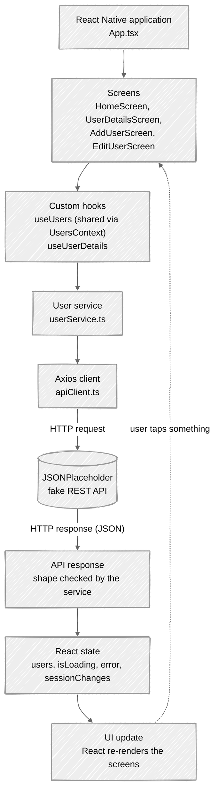
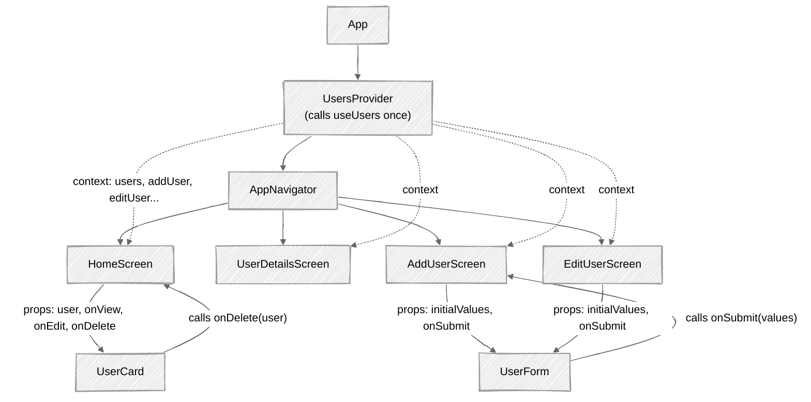
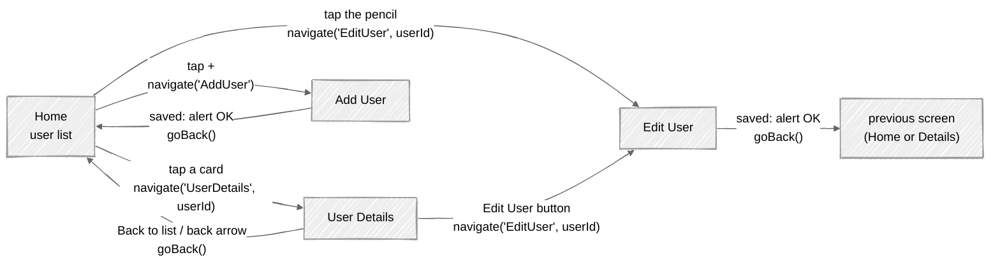

# 02 · Application Architecture

This document explains **how the app is organised**: which file does what, how the pieces talk to
each other, and *why* it is built this way.

---

## 1. Overall architecture



**How to read it:**

- Requests travel **down**: a **screen** asks a **hook** to do something, the hook asks the **service**,
  the service uses the **Axios client**, and Axios sends an HTTP request to **JSONPlaceholder**.
- Answers travel **back up**: the **response** is checked, stored in **React state**, and React
  **re-renders** the screens that use that state.
- Each layer only talks to the layer **directly below** it. A screen never calls Axios, and the
  service never touches React state. This makes each piece small, testable and replaceable.

| Layer | File(s) | Knows about | Does NOT know about |
|---|---|---|---|
| Screens | `src/screens/*` | What to show, when to navigate, which dialog to open | URLs, HTTP, Axios |
| Hooks + context | `src/hooks/*`, `src/context/*` | App state, the fake-API strategy | How to draw the UI |
| Service | `src/services/userService.ts` | URLs, HTTP methods, response shapes | React, screens |
| API client | `src/services/apiClient.ts` | Base URL, timeout, headers, logging | Users, screens |

## 2. Folder structure

```text
react-native-simple-app/
├── App.tsx                     Root component: providers + navigator
├── index.ts                    Entry point: registerRootComponent(App)
├── app.json                    Expo configuration (name, icons, plugins)
├── package.json                Dependencies and npm scripts
├── tsconfig.json               TypeScript settings (strict mode)
├── jest.setup.js               Test setup (mocks for safe area + icons)
├── __tests__/App.test.tsx      Integration tests: whole app, every CRUD flow
│
├── src/
│   ├── navigation/
│   │   ├── AppNavigator.tsx    The stack of screens
│   │   └── types.ts            Screen names + their parameters (typed)
│   │
│   ├── screens/
│   │   ├── HomeScreen.tsx      List, refresh, delete, add button
│   │   ├── UserDetailsScreen.tsx
│   │   ├── AddUserScreen.tsx
│   │   └── EditUserScreen.tsx
│   │
│   ├── components/
│   │   ├── UserCard.tsx        One row of the list
│   │   ├── UserForm.tsx        Shared form for Add and Edit
│   │   ├── CustomButton.tsx    Button with variants + loading spinner
│   │   ├── CustomInput.tsx     Label + TextInput + error message
│   │   ├── IconButton.tsx      Round icon-only button (edit/delete)
│   │   ├── LoadingIndicator.tsx
│   │   ├── EmptyState.tsx      Empty list / error / not found message
│   │   ├── MessageBanner.tsx   Inline info or error message
│   │   ├── InfoRow.tsx         "Label: value" row on the details screen
│   │   └── __tests__/
│   │
│   ├── context/
│   │   └── UsersContext.tsx    Shares ONE useUsers() instance with all screens
│   │
│   ├── hooks/
│   │   ├── useUsers.ts         List state + create/update/delete logic
│   │   ├── useUserDetails.ts   Loads one user for the details screen
│   │   └── __tests__/
│   │
│   ├── services/
│   │   ├── apiClient.ts        Configured Axios instance
│   │   ├── userService.ts      getUsers, getUserById, createUser, updateUser, deleteUser
│   │   └── __tests__/          Unit tests + live API tests
│   │
│   ├── types/
│   │   ├── User.ts             User, UserRequest, UserResponse, SessionChange
│   │   └── icon.ts             Type of a valid icon name
│   │
│   ├── utils/
│   │   ├── validation.ts       Form rules (pure functions)
│   │   ├── errorHandling.ts    Error -> human-friendly message
│   │   ├── formatters.ts       Initials, address formatting
│   │   └── __tests__/
│   │
│   ├── constants/
│   │   ├── apiConstants.ts     Base URL, timeout, endpoints
│   │   └── theme.ts            Colours, spacing, corner radius
│   │
│   └── test-utils/
│       └── fixtures.ts         Sample users for tests
│
└── docs/                       This documentation
```

### Differences from the suggested structure in the requirements

The requirements allowed small adjustments. These were added, each for a concrete reason:

| Added | Why |
|---|---|
| `src/context/UsersContext.tsx` | Screens must share **one** user list (see [section 5](#5-hook-layer-and-shared-state)). |
| `src/hooks/useUserDetails.ts` | Keeps the details screen free of API code (screen → hook → service). |
| `src/navigation/types.ts` | Screen parameter types, imported by every screen. |
| `UserForm`, `IconButton`, `MessageBanner`, `InfoRow` | Avoid duplicating the same UI in several screens. |
| `src/constants/theme.ts`, `src/types/icon.ts` | One place for colours, and type-safe icon names. |
| `src/utils/errorHandling.ts`, `formatters.ts` | Shared logic that is easy to unit-test. |

## 3. Responsibility of every folder

| Folder | Responsibility | Rule of thumb |
|---|---|---|
| `navigation/` | Which screens exist, their order, their parameters, header style | Only navigation setup here |
| `screens/` | One file per screen. Reads state from hooks, renders components, handles navigation and dialogs | No HTTP calls, no business rules |
| `components/` | Small reusable UI pieces. Receive data via props, report events via callbacks | Should not know which screen they are on |
| `context/` | Makes shared state available to every screen | Only wiring, no logic |
| `hooks/` | State + logic: loading flags, errors, CRUD functions, the fake-API strategy | No JSX, no styling |
| `services/` | Talking to the API: URLs, methods, request bodies, response checks | No React imports |
| `types/` | TypeScript interfaces shared across layers | No runtime code |
| `utils/` | Pure helper functions (validation, formatting, error messages) | Same input → same output; easy to test |
| `constants/` | Fixed values (API URL, colours) | Change once, applies everywhere |

## 4. Component communication



**Three ways components communicate in this app:**

1. **Props go down** (solid arrows). The parent gives data to the child: `HomeScreen` → `UserCard user={item}`.
2. **Callbacks go up**. The parent gives the child a function, and the child calls it when something
   happens: `UserCard` calls `onDelete(user)`, `UserForm` calls `onSubmit(values)`.
3. **Context goes everywhere** (dotted arrows). Data that **many screens** need (the user list and the
   CRUD functions) is provided once by `UsersProvider`, and any screen can read it with
   `useUsersContext()` without passing props through every level.

## 5. Hook layer and shared state

### `useUsers` (the "brain")

[`src/hooks/useUsers.ts`](../src/hooks/useUsers.ts) owns the state:

```ts
const [users, setUsers] = useState<User[]>([]);
const [isLoading, setIsLoading] = useState(true);
const [isRefreshing, setIsRefreshing] = useState(false);
const [error, setError] = useState<string | null>(null);
const [sessionChanges, setSessionChanges] = useState<Record<number, SessionChange>>({});
```

It exposes functions: `loadUsers`, `refreshUsers`, `addUser`, `editUser`, `removeUser`, `findUser`.
Each one calls the service, waits for success, and **then** updates state.

### Why a Context? (important beginner lesson)

**Every call to a hook creates its own, separate state.** If both `HomeScreen` and `AddUserScreen`
called `useUsers()`, there would be **two different lists**. A user created on the Add screen would be
added to the Add screen's copy, and Home would never see it.

The fix is to call `useUsers()` **exactly once** and share the result:

```tsx
// src/context/UsersContext.tsx
export function UsersProvider({ children }: { children: ReactNode }) {
  const usersState = useUsers();                       // the ONE instance
  return <UsersContext value={usersState}>{children}</UsersContext>;
}

export function useUsersContext(): UsersState {      // what screens call
  const context = useContext(UsersContext);
  if (!context) throw new Error('useUsersContext must be used inside <UsersProvider>.');
  return context;
}
```

This is React's **built-in** way to share state, so no Redux or other state library is needed.

### `useUserDetails`

[`src/hooks/useUserDetails.ts`](../src/hooks/useUserDetails.ts) loads **one** user for the details
screen with its own `isLoading` / `error` state. It also decides **which copy** to show (server or
app memory). See [section 9](#9-strategy-for-the-fake-api).

## 6. API service layer

- [`apiClient.ts`](../src/services/apiClient.ts) creates **one** Axios instance with the base URL,
  a 10-second timeout and JSON headers, plus interceptors that log every request in development.
- [`userService.ts`](../src/services/userService.ts) has one function per API operation:

| Function | HTTP | Returns |
|---|---|---|
| `getUsers()` | `GET /users` | `User[]` |
| `getUserById(id)` | `GET /users/{id}` | `User` |
| `createUser(user)` | `POST /users` | `UserResponse` (data + `id`) |
| `updateUser(id, user)` | `PUT /users/{id}` | `UserResponse` |
| `deleteUser(id)` | `DELETE /users/{id}` | nothing (`void`) |

Because **only** the service knows URLs, switching to a real backend later means changing
`apiConstants.ts` (and maybe `userService.ts`). No screen needs to change.

Details: [04 API Communication](04-api-communication.md).

## 7. Navigation flow



**Explanation:**

- All screens live in **one stack**. `navigate` pushes a screen on top. `goBack` pops it.
- After saving, the Add/Edit screens call `goBack()`, so the user returns to **wherever they came
  from**: Home, or the Details screen if they started editing there.
- The back arrow in the header and the Android back button also call `goBack()` automatically.

The routes are typed in [`navigation/types.ts`](../src/navigation/types.ts):

```ts
export type RootStackParamList = {
  Home: undefined;                 // no parameters
  UserDetails: { userId: number };
  AddUser: undefined;
  EditUser: { userId: number };
};
```

## 8. Data flow between screens

**We pass the user's `id`, never the whole user object, between screens.**

```ts
navigation.navigate('EditUser', { userId: user.id });   // ✅ what this app does
navigation.navigate('EditUser', { user });              // ❌ avoided
```

Why?

- The receiving screen looks the user up in the **shared state** (`findUser(userId)`), so it always
  shows the **latest** version, even if the user was edited a moment ago.
- Navigation parameters should be small and serializable (React Navigation's own recommendation).
- There is a single source of truth: the `users` array in `useUsers`.

When a screen changes data, it calls a context function (`addUser`, `editUser`, `removeUser`). That
updates the shared state, and **every** screen that reads it re-renders with the new data. This is how
the Home list "magically" shows a new user after you return from the Add screen.

## 9. Strategy for the fake API

> **JSONPlaceholder does not save anything.** It answers `POST`, `PUT` and `DELETE` *as if* they
> worked, but the next `GET` returns the original data again. These facts were verified against the
> live API (see `npm run test:live`).

| What JSONPlaceholder does | Problem for the app | What the app does |
|---|---|---|
| `GET /users` always returns the **original 10 users** | Fetching again would undo the user's changes | The `users` array in React state is the **source of truth for the session**. It is only replaced when the user explicitly refreshes. |
| `POST /users` **always** returns `id: 11` | Two created users would share id 11 (broken list keys, wrong edits) | `addUser` keeps 11 if it is free, otherwise picks the next free id with `getNextLocalId`. |
| `PUT /users/{id}` returns **only the fields sent** (no address/company) | Replacing the user with the response would lose the address and company | `editUser` **merges**: `{ ...existing, ...response, id }`. |
| `PUT /users/11` (a created user) returns **404** | You could never edit a user you just created | For users marked `created`, `editUser` skips the request and updates locally. The Edit screen says so in a blue info box. |
| `GET /users/11` returns **404**, and `GET /users/1` returns old data after an edit | The details screen would show an error or stale data | `useUserDetails` skips the request for users created or edited in this session and shows the app's copy, labelled *"Source: app memory (this session)"*. |
| `DELETE` returns `200 {}` but deletes nothing | — | The user is removed from local state after the `200`. |

The hook remembers which records differ from the server in `sessionChanges`:

```ts
// e.g. { 11: 'created', 1: 'updated', 2: 'deleted' }
const [sessionChanges, setSessionChanges] = useState<Record<number, SessionChange>>({});
```

This is used to:

- show **"New"** and **"Edited"** badges on the cards,
- show *"3 unsaved change(s) in this session"* on the Home screen,
- **warn before refreshing**: *"Reload original data? ... reloading brings back the original users."*

**Why does data go back to the original after a restart or refresh?**
Because the changes only ever lived in the phone's memory (React state). Restarting the app clears
memory, and refreshing replaces the list with the server's data, which never changed. With a **real**
backend, the server would store the changes and a refresh would return them.

## 10. Key technical decisions

| Decision | Alternatives considered | Reason |
|---|---|---|
| **Expo SDK 58** (latest stable) | Older SDK | Expo Go in the app stores only supports the newest SDK. |
| **React Navigation (native stack)** | Expo Router (Expo's default) | Required by the project brief, and explicit navigation is easier to learn first. |
| **React Context** for shared state | Redux, Zustand | Built into React. No extra library for a small app (as required). |
| **Pessimistic updates**: update the UI *after* the API succeeds | Optimistic: update first, roll back on error | Simpler to understand, and matches the requirement "remove after a successful response, keep on failure". |
| **One `UserForm`** for Add and Edit | Two separate forms | No duplicated validation or layout. |
| **`Alert.alert`** for confirmations and results | Custom toast library | Built in, native look, no dependency. |
| **Validation on submit**, then live re-validation of fields that show an error | Validate every keystroke | Does not shout at the user before they finish typing. |
| **Runtime response check** in the service | Trust the API blindly | TypeScript types do not exist at runtime. This protects the UI from bad data. |
| **`FlatList`** for the list | `ScrollView` + `.map()` | Renders only visible rows (required by the brief). |

---

**Next:** [03 · Application Workflows →](03-application-workflows.md)
