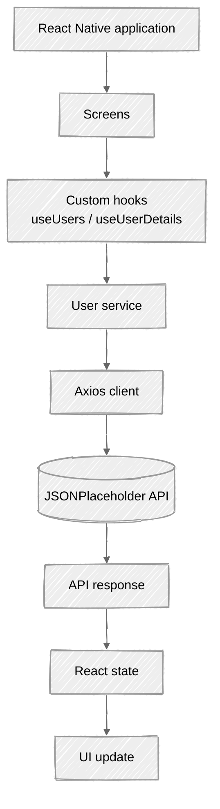
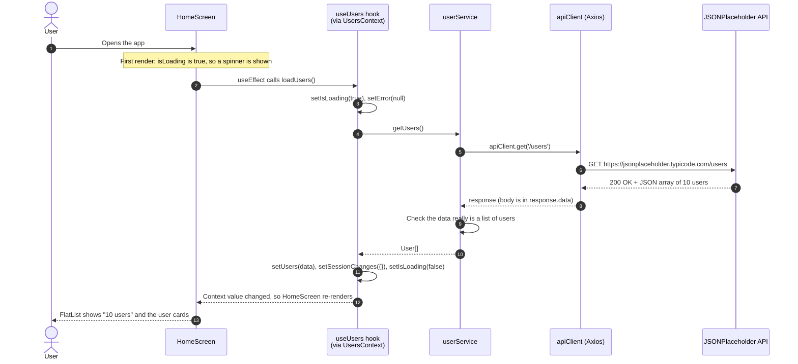
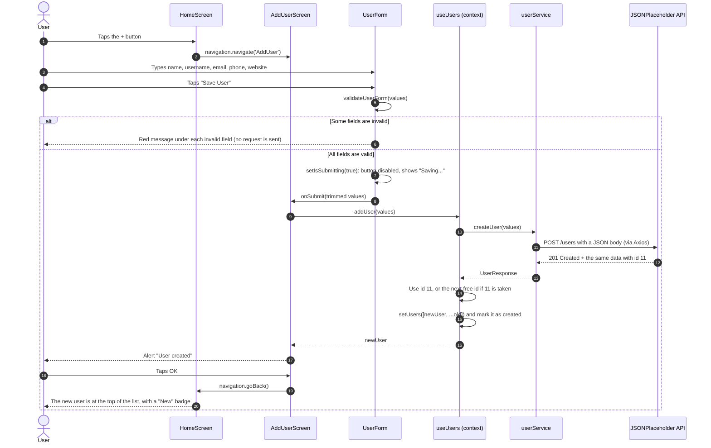
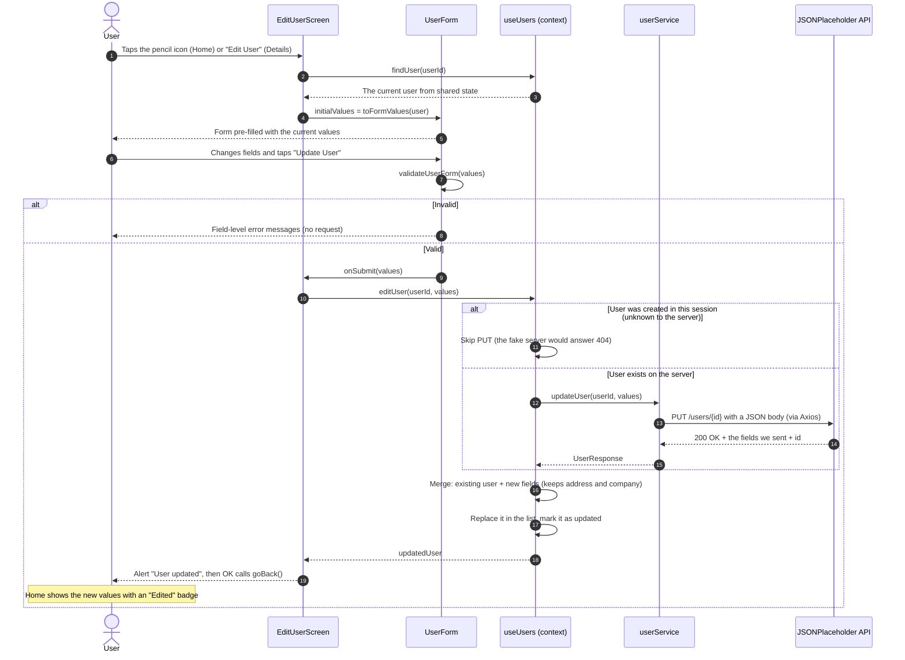
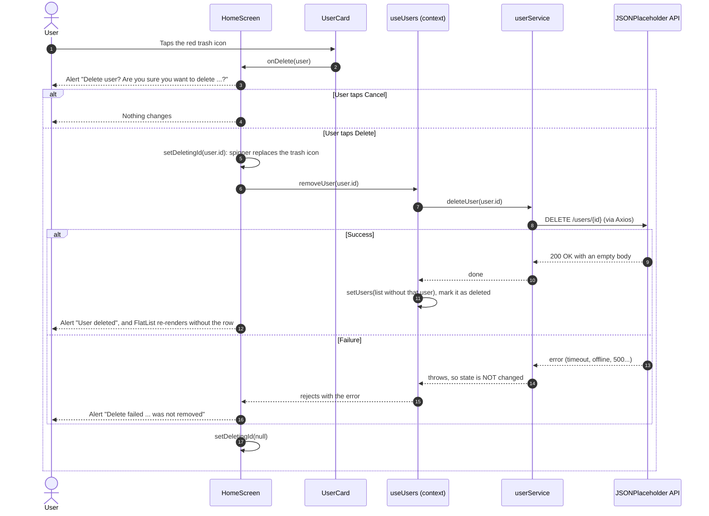
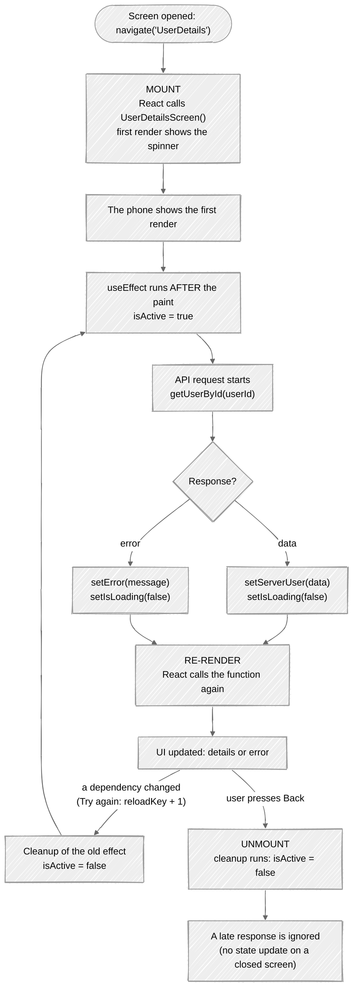
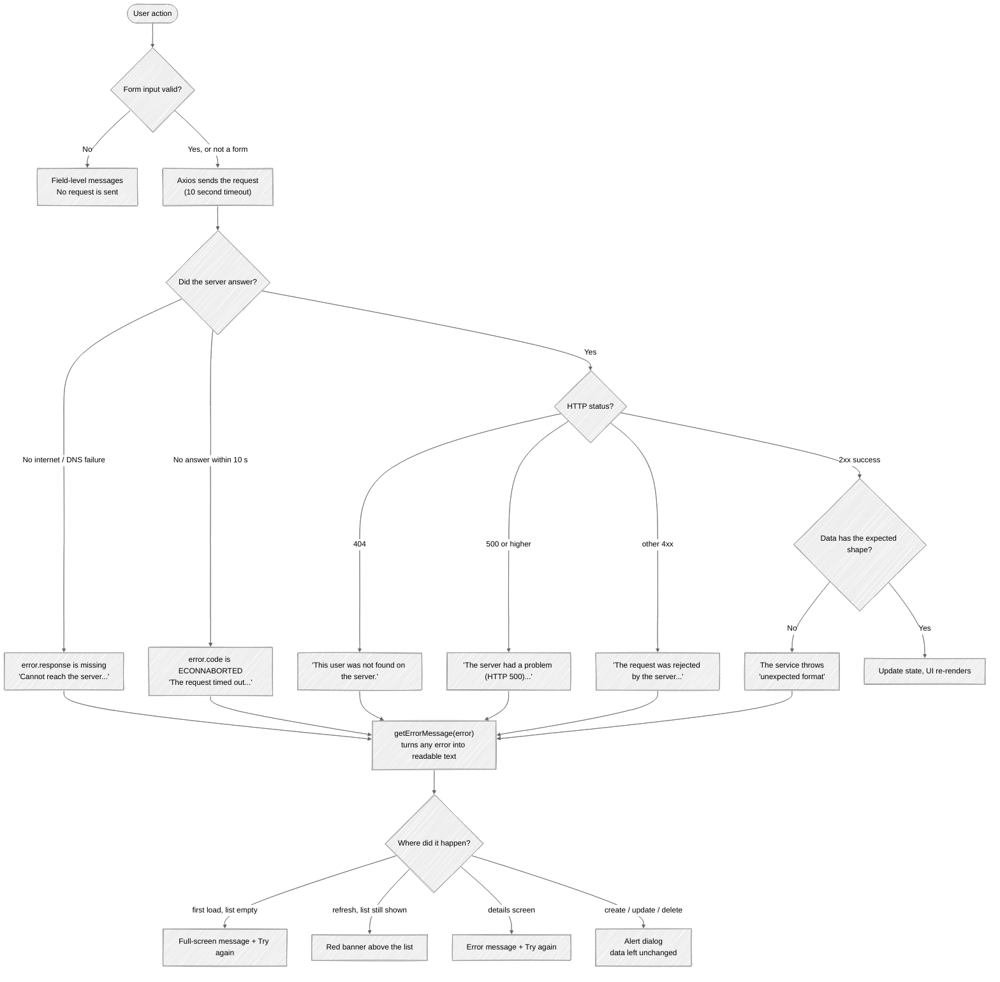

# 03 · Application Workflows

This document walks through **everything the app does**, step by step, with a diagram for each workflow.
Each diagram is followed by a plain-language explanation.

| Diagram | Topic |
|---|---|
| [A](#a-overall-architecture) | Overall architecture |
| [B](#b-application-startup-and-user-list-loading) | Application startup and user list loading |
| [C](#c-create-user-post) | Create user (`POST`) |
| [D](#d-read-user-details-get) | Read user details (`GET`) |
| [E](#e-update-user-put) | Update user (`PUT`) |
| [F](#f-delete-user-delete) | Delete user (`DELETE`) |
| [G](#g-react-component-lifecycle) | React component lifecycle |
| [H](#h-error-handling) | Error handling |

> **Tip:** these diagrams are written in [Mermaid](https://mermaid.js.org/), so they stay editable
> as text. GitHub renders them automatically. In VS Code, install a Mermaid preview extension
> (for example *"Markdown Preview Mermaid Support"*) and open the Markdown preview.

---

## A. Overall architecture



**Explanation:** every feature follows this same path. A **screen** never talks to the internet
itself. It asks a **hook**, the hook asks the **user service**, and the service uses the shared
**Axios client** to send an HTTP request to **JSONPlaceholder**. The **response** comes back up, is
stored in **React state**, and React **updates the UI** automatically. The architecture is explained
in detail in [02 Architecture](02-application-architecture.md).

---

## B. Application startup and user list loading



**Explanation (application startup):**

1. `index.ts` starts the app, and `App.tsx` renders `SafeAreaProvider` → `UsersProvider` → `AppNavigator`.
   `UsersProvider` calls `useUsers()` once, creating the shared state (`users = []`, `isLoading = true`).
2. The navigator shows the first screen, **HomeScreen**. Because `isLoading` is `true`, it renders
   `<LoadingIndicator message="Loading users..." />`.
3. **After** that first render, React runs Home's `useEffect`, which calls `loadUsers()`.
4. `loadUsers` → `getUsers()` → `apiClient.get('/users')` → Axios sends the HTTP `GET`.
5. JSONPlaceholder answers **200 OK** with a JSON array. Axios parses the JSON into a JavaScript array.
6. The service checks that every item has an `id`, `name`, `username` and `email`.
7. The hook stores the list with `setUsers(data)` and sets `isLoading` to `false`.
8. Changing state makes React **re-render** HomeScreen. This time it renders the `FlatList`.

**Pull-to-refresh / Refresh button** follows the same path through `refreshUsers()`, but it sets
`isRefreshing` (small spinner) instead of `isLoading` (full-screen spinner). If there are unsaved
session changes, an `Alert` first asks *"Reload original data?"*, because the fake API never stored them.

---

## C. Create user (POST)



**Explanation:**

1. The floating **+** button calls `navigation.navigate('AddUser')`, and the Add User screen slides in.
2. `AddUserScreen` renders the shared `UserForm` with empty values. Every keystroke updates the
   form's state (`setValues`), which is called a **controlled input**.
3. On **Save User**, the form runs `validateUserForm`. If anything is invalid, it shows field-level
   messages and **stops**: no HTTP request is sent.
4. If valid, `isSubmitting` becomes `true`: the button shows a spinner and *"Saving..."* and is
   **disabled**, so a double tap cannot create two users.
5. The screen's `handleCreate` calls `addUser(values)` from the context. The hook calls
   `createUser`, and Axios sends `POST /users` with the JSON body.
6. JSONPlaceholder answers **201 Created** with our data plus `id: 11` (always 11, see
   [02 §9](02-application-architecture.md#9-strategy-for-the-fake-api)).
7. The hook adds the user to the **top** of the shared list and records it as `created` in `sessionChanges`.
8. The screen shows a success `Alert`. Tapping **OK** calls `goBack()`. Home re-renders with the new
   user, because it reads the **same** shared state.
9. If the request fails, the `catch` block shows *"Could not create user"* with the reason, and the form
   stays open with the user's input intact.

---

## D. Read user details (GET)

```mermaid
sequenceDiagram
    autonumber
    actor User
    participant Home as HomeScreen
    participant Details as UserDetailsScreen
    participant Hook as useUserDetails
    participant Service as userService
    participant API as JSONPlaceholder API

    User->>Home: Taps a user card
    Home->>Details: navigation.navigate('UserDetails', userId)
    Details->>Hook: useUserDetails(userId)
    alt User was created or edited in this session
        Hook-->>Details: The copy from app memory (no request)
        Details-->>User: Details + note "Source: app memory (this session)"
    else Unchanged user
        Note over Details: isLoading is true, so a spinner is shown
        Hook->>Service: getUserById(userId), inside useEffect
        Service->>API: GET /users/{id} (via Axios)
        alt Success
            API-->>Service: 200 OK + the full user (address, company)
            Service-->>Hook: User
            Hook->>Hook: setServerUser(data), setIsLoading(false)
            Details-->>User: Contact, address and company + "Source: GET /users/{id}"
        else Failure (offline, timeout, 404...)
            API-->>Service: error
            Service-->>Hook: throws
            Hook->>Hook: setError(friendly message)
            Details-->>User: "Could not load this user" + Try again button
        end
    end
```

**Explanation:**

1. Tapping a card calls `navigation.navigate('UserDetails', { userId })`. Only the **id** is passed.
2. `UserDetailsScreen` reads `route.params.userId` and calls the `useUserDetails(userId)` hook.
3. For an **unchanged** user, the hook's `useEffect` calls `getUserById`, which sends `GET /users/{id}`.
   While waiting, the screen shows *"Loading user details..."*.
4. The response contains everything, including **address** and **company**, which the screen
   displays in sections. A small caption shows where the data came from: `Source: GET /users/2`.
5. For a user **created or edited in this session**, the fake server would answer `404` or return the
   *old* data. So the hook skips the request and shows the copy from shared state, with an
   explanatory blue note.
6. If the request fails, the screen shows the error and a **Try again** button, which re-runs the effect.
7. If the user presses **Back** before the response arrives, the effect's **cleanup** marks the request
   as stale, and the late answer is ignored (see [diagram G](#g-react-component-lifecycle)).

---

## E. Update user (PUT)



**Explanation:**

1. The Edit screen receives `userId` and loads the user with `findUser(userId)` from **shared state**,
   not from the API, because shared state already contains any earlier edits from this session.
2. `toFormValues(user)` copies the five editable fields into the form, so the form is **pre-filled**.
3. Validation works exactly as in Create.
4. `editUser` sends `PUT /users/{id}`. JSONPlaceholder's response contains **only the fields we sent**
   (no address, no company), so the hook **merges** it into the existing record:
   `{ ...existing, ...response, id }`.
5. The list is updated with `.map()` (replace one item, keep the rest). The record is marked
   `updated`, which shows an **"Edited"** badge on Home.
6. **Special case:** users created in this session do not exist on the server, so `PUT` would return
   `404`. For them the hook updates the data locally only, and the Edit screen explains this in a blue
   info box.
7. On failure, an `Alert` says *"Update failed ... Your changes were not applied."* and the old data stays.

---

## F. Delete user (DELETE)



**Explanation:**

1. The card does not delete anything itself. It calls the `onDelete` prop, which is the Home screen's
   `confirmDelete` function.
2. `confirmDelete` opens a native **confirmation dialog** with `Alert.alert` and two buttons:
   **Cancel** and a red **Delete** (`style: 'destructive'`).
3. Only if the user taps **Delete** does `deleteConfirmed` run. It stores `deletingId`, which swaps the
   trash icon for a small spinner on that card.
4. `removeUser` **first** awaits `DELETE /users/{id}`. Only after a successful response does it remove
   the user from state with `.filter()`. If the request throws, the lines that change state never run,
   so the **record stays** in the list.
5. `FlatList` re-renders without the deleted row, and the count drops (*"9 users"*).
6. Success or failure is reported with an `Alert`. The `finally` block always clears `deletingId`.

---

## G. React component lifecycle



**Explanation (using `useUserDetails` as the example):**

| Phase | What happens in this app |
|---|---|
| **Mounting** | The screen appears for the first time. React calls the component function and the screen shows the loading spinner. |
| **`useEffect`** | Runs **after** the screen is painted, so fetching never blocks the first frame. It starts `getUserById(userId)`. |
| **API request** | Runs in the background (it is `async`). The UI stays responsive. |
| **State update** | When the answer arrives, `setServerUser(...)` / `setError(...)` / `setIsLoading(false)` are called. |
| **Re-render** | Because state changed, React calls the component again and updates only what changed on screen. |
| **Effect re-run** | The effect has dependencies `[userId, hasLocalChanges, reloadKey]`. **Try again** increments `reloadKey`, so React first runs the **cleanup** of the old effect, then the effect again. |
| **Unmounting** | Pressing **Back** removes the screen. React runs the **cleanup function** (`isActive = false`), so if the response arrives later, it is ignored. |

The code that implements this pattern:

```ts
useEffect(() => {
  if (hasLocalChanges) return;
  let isActive = true;                       // this run of the effect is "alive"

  const load = async () => {
    setIsLoading(true);
    setError(null);
    try {
      const data = await getUserById(userId);
      if (isActive) setServerUser(data);     // only if the screen is still shown
    } catch (err) {
      if (isActive) setError(getErrorMessage(err));
    } finally {
      if (isActive) setIsLoading(false);
    }
  };
  load();

  return () => { isActive = false; };        // cleanup: on unmount or before re-running
}, [userId, hasLocalChanges, reloadKey]);
```

---

## H. Error handling



**Explanation of each failure:**

| Situation | How it is detected | What the user sees |
|---|---|---|
| **Form validation fails** | `validateUserForm` returns messages before any request | Red text under each invalid field, and the input border turns red |
| **Internet unavailable** | Axios error with **no** `error.response` | *"Cannot reach the server. Check your internet connection and try again."* |
| **Request times out** | Axios error with `code === 'ECONNABORTED'` after 10 s (`API_TIMEOUT_MS`) | *"The request timed out. Check your connection and try again."* |
| **API returns an error** | `error.response.status` is 404 / 5xx / other 4xx | A message naming the problem, e.g. *"The server had a problem (HTTP 500)..."* |
| **Unexpected response** | `isUserLike` check in `userService.ts` fails (e.g. HTML instead of JSON) | *"The server sent data in an unexpected format."* |

All conversions happen in one function, [`getErrorMessage`](../src/utils/errorHandling.ts), so every
screen shows consistent messages. **Errors never leave the app in a broken state:** for create, update
and delete, state only changes **after** a successful response.

---

**Next:** [04 · API Communication →](04-api-communication.md)
